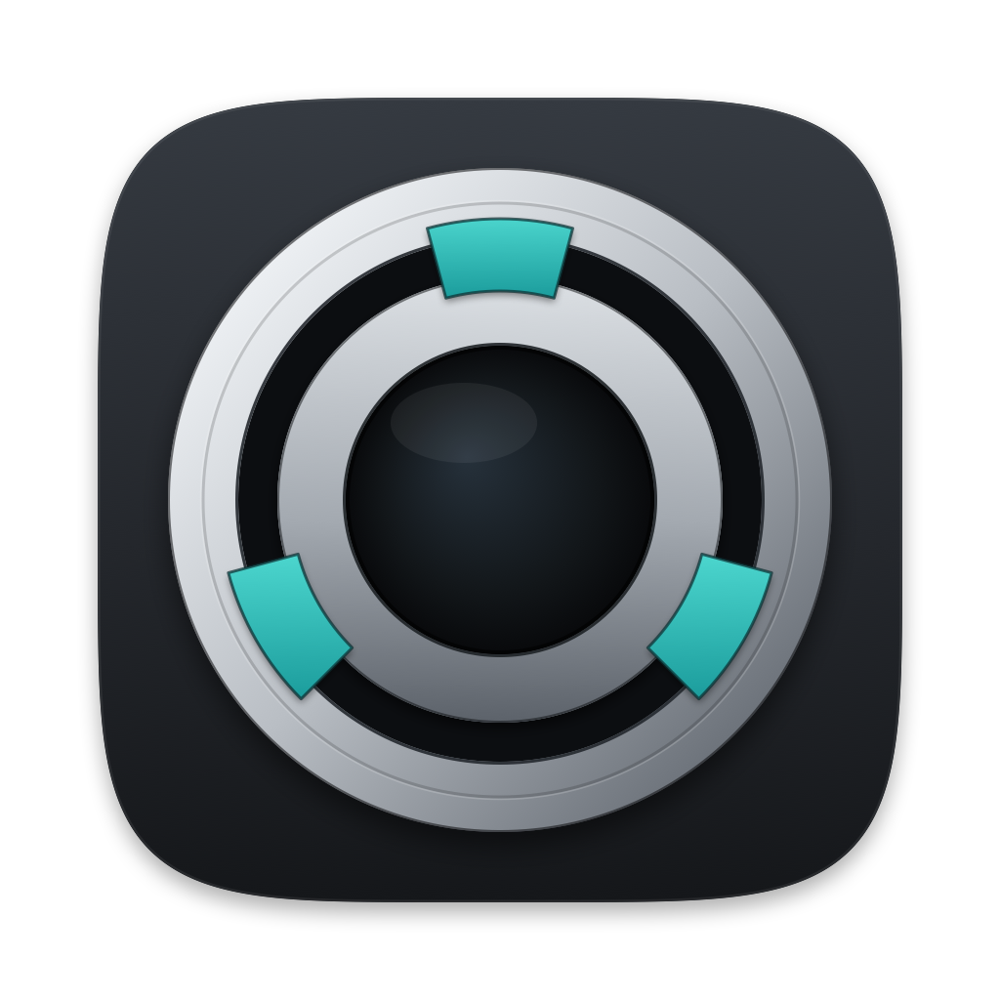

# OpenLensAdapter



Open firmware and a native macOS companion for adapting manual lenses to Sony
E-mount cameras. The first hardware target is the Techart LM-EA9, built on
[weiziqian's upstream C implementation](https://github.com/weiziqian/E-mount-impl-on-Techart-EA9).
Our current setup is a Sony A7C II with a Zeiss Jena Biotar 58mm f/2.

**4.5.0 is the working baseline.** The owner confirms autofocus, photos,
aperture-dial control and shutdown work. Its complete application and protected
data were verified after USB reconnect. The Sony dial selects a reported
f/2–f/16; the physical iris is controlled by the lens ring.
[Camera and installation record](docs/evidence/biotar-45-install-2026-11-07.md).

**4.6.0 is prepared offline** with the requested reported f/1.2–f/22 range,
starting at f/2. It retains the Biotar's nominal 58mm/f/2 profile and the
working motor/handshake implementation. It needs a separate upload and camera
check. [Candidate notes](firmware/releases/4.6.0/README.md).

The native app opens on Device: connection, verified firmware and compiled
lens information. Lens Library is the secondary tab. USB tools provide guarded
backup, installation, reconnect verification and original stock recovery.
Library edits stay local; these releases compile their lens profile into the
image. The physical iris is always shown as unknown.

## Project layout

| Path | Purpose |
| --- | --- |
| [firmware/core](firmware/core/) | E-mount protocol, focus mapping, optical data and aperture reporting |
| [firmware/targets](firmware/targets/) | Hardware-specific source, linker, build rules and memory layout |
| [firmware/configurations](firmware/configurations/) | Editable lens/build recipe examples |
| [firmware/hosttest](firmware/hosttest/) | Production-path protocol and simulated motor tests |
| [firmware/releases](firmware/releases/) | Immutable image, manifest and evidence pins |
| [firmware/recovery](firmware/recovery/) | Original stock 1.8.0 and encrypted same-unit recovery |
| [apps/macos](apps/macos/) | SwiftUI app, IOHID service and `ea9ctl` |
| [profiles](profiles/) | The owner's eight lens profiles |
| [references](references/README.md) | Upstream firmware, protocol, REA and traffic references |
| [docs](docs/development.md) | Current development, USB and testing documentation |

## Build

```sh
make firmware  # Reproduce the exact working image; no USB access
make test      # C regressions, failing controls, native USB/app tests
make app       # Build and sign dist/OpenLensAdapter.app and dist/ea9ctl locally
```

See [development](docs/development.md) for the pinned compiler/header dependencies,
[USB protocol and workflow](docs/usb-protocol.md), and [testing](docs/testing.md).

## Customize

Copy the [50mm f/1.4 example](firmware/configurations/contax-50-f14.example.json),
set your lens name, focal length and reported aperture range, and choose a new
version. Build it without accessing USB:

```sh
python3 scripts/build-firmware.py --config firmware/configurations/contax-50-f14.example.json \
  --output artifacts/private/my-custom-firmware
python3 scripts/test-firmware-config.py --build artifacts/private/my-custom-firmware
```

The example's protocol test checks the example lens; adapt its expected values
for your own profile. Custom builds contain a manifest with source/configuration
hashes and stay separate from tested releases. The app installs explicitly pinned
images only. See [customizing lenses and hardware](docs/customization.md) for the
porting boundaries and the process for adding an image to the app.

The app and repository are now **OpenLensAdapter**. Existing library, USB backup,
update journal and recovery-key locations are retained. [Rename record](docs/openlensadapter-rename.md).

Earlier experiments were removed from the active tree and application. Their
complete source, evidence and original pins remain under the Git tag
`archive/pre-4.5-baseline`. [History and archive policy](docs/history.md).
The working firmware is unchanged by this repository/app restructure; factory
parity and compatibility with other camera/lens combinations are not claimed.
