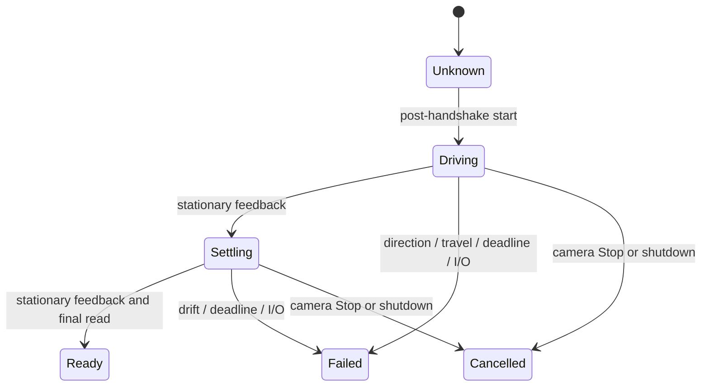

> Current source/app follow-up: [AF 2.4 factory-derived baseline](reverse-engineering/factory-af-baseline.md), built with `--variant factory-af`. Explicit AF install selects 2.4; 2.0–2.3 artifacts are frozen. The material below records earlier milestones.

# AF 2.2: reference, timing and completion reconciliation

This document records the 2.2 design and historical commands. Current source
builds the separate [2.3 hardening candidate](evidence/software-polish-2026-10-11.md)
with `--variant hardened-af`; `--variant reconciled-af` verifies the frozen 2.2
resource. Current native `prepare-af`/`apply-af` select 2.3, while normal profile
changes preserve the verified installed firmware. To reproduce a historical
2.2 personalized image offline, use `scripts/prepare-af.py --variant reconciled-af`
with a metadata-2.0 profile input and a new output path. To rebuild its source,
use the recorded pre-hardening commit `458be6b0f78cefed80cd4650894f600be71a8135`
and the dated 2.2 manifest. The offline hardening pass did not change the installed
unit. The subsequent [2.3 installation and reconnect verification](evidence/af-23-upload-2026-10-11.md)
upgraded it; this document retains the historical 2.2 design and observations.


The modular **2.2.0** candidate for Contax Zeiss 50mm f/1.4 was installed and
byte-verified after owner-confirmed physical USB-cap reconnect. It passed the
[software checks](evidence/af-reconciliation-2026-10-10.md); see the separate
[historical installation record](evidence/af-22-upload-2026-10-11.md). The initial
[2.2 camera observation](evidence/af-22-camera-lifecycle-2026-10-11.md) now reports
normal camera startup, no observed startup movement without input, quiet idle
and normal motor shutdown. Display power-off, reference acquisition and
focus-command movement remain unverified. The owner reported motor movement and proper A7C II
shutdown with the earlier byte-verified 2.1 image; focus acquisition and sharpness
remain pending the C/Y-to-M converter.

## Evidence and adopted policy

Sources are the immutable upstream C snapshot at
`d52ed06cc449918f938e0695fbf29a0c4141f2b2`, and the REA lane's
[factory 1.8 dossier](reverse-engineering/stock-phase2.md), including original-instruction
checks and synthetic fixtures. The factory dossier records the confidence and
limits of each reconstruction. These findings establish arithmetic and control
flow, not this adapter's travel, polarity, friction or camera timing.

| Topic | Factory findings | Upstream replacement | 2.2 decision |
| --- | --- | --- | --- |
| Position origin | Signed `(target−4096)×4`; raw reference restored from NVM | Mechanical zero maps to advertised lower limit 4144 | Explicit 192-count bridge between the coordinate spaces; same bounded 4144..5632 mapping |
| Encoder | Asymmetric reference-relative wrap | Unwrapped successive shortest deltas modulo 16384 | Retain upstream tracking; do not load the factory raw reference into this coordinate space |
| Startup reference | Ordinary enabling writer for homing gate remains unresolved | Deliberate post-handshake homing experiment | Bounded drive/settle state machine; commit zero only after both stages and a final fault-free read |
| Controller | Direction-latched stepped speed, incremental PID; retained history | Velocity profile, feedforward, proportional correction and boost | Retain upstream tuning; rename `STOCK` to `UPSTREAM_PROFILE` |
| Cadence | Nominal PID period 13.751833 ms at recovered 48 MHz config | Polled after at least 5 ms, actual elapsed time | Keep 5 ms; inhibit motion if a non-braking control gap exceeds 40 ms |
| Completion | Position crossing and timeout share a completion flag | Arrival checks and motion guards | Separate event eligibility; failed Move/Scan/Drive cannot announce success; explicit Stop remains acknowledged |
| Persistence | 44 bytes mix reference, focal and live motion state | Session reference in RAM | Do not import live factory state or write its settings record |

Changing the upstream controller to factory cadence without retuning would
change its feedforward, acceleration and boost behavior. A separate factory
controller comparison can use the REA models; this candidate does not port the
factory PID or pretend its timing was measured on hardware.

## Position spaces

`focus_map.c` now names both origins and exposes pure conversion functions:

```text
mechanical counts:      0 .. 5952
factory-reference space = mechanical + 192
protocol position       = 4096 + factory-reference / 4
                        = 4144 + mechanical / 4
```

Targets are still clamped at the advertised bounds. Absolute `0x7fff` is
rejected by the command layer. No-target, relative and defocus cases continue
through `af_control.c`, with widened arithmetic before clamping. Synthetic
factory target 12288 wraps to −32768 in stock; the candidate safely clamps it.
This bridge makes the difference explicit without changing accepted target
resolution. It does **not** prove that stock's persisted reference is physically
192 counts away from a newly homed stop. The 5952-count/4.5-mm geometry and
optical distance/prediction declarations remain upstream assumptions.

## Broader REA results and retained flash

The subsequently completed [whole-firmware ledger](reverse-engineering/whole-firmware-reconstruction.md)
adds 380 annotated application/bootloader entries and
[38 bounded C host-model routines](reverse-engineering/stock-host-model.md),
with 24,991 differential cases/steps reported by the REA lane. The new main-loop
models retain the unresolved ordinary homing gate and external-action boundaries;
they do not establish motor mechanics or arbitrary interrupt ordering. App DFLL
configuration is open-loop, reinforcing that recovered timing is nominal.

There is a material layout finding: the original unit dump contains an unknown
128-byte prefix at `0xa000` and a second exact factory application copy starting
at `0xa080`. The legacy custom 2.0/2.1 profile row replaces that prefix and the
first 128 bytes of the duplicate. Purpose/writer/lifetime remain unresolved; no
ordinary boot use has been established. Previous unchanged-tail checks from
`0xa100` onward do **not** prove preservation of an entire factory recovery image.

The final 2.2 candidate addresses this overlap by placing its profile at
`0x9f00..0x9fff`, within its own custom application span. Its upload now covers
exactly `[0x5000,0xa000)`, 20,480 bytes / 320 pages, plus START. It never writes
`0xa000` or anything above it. The linker reserves this row and checks code/data
fit before it. Native image generation, journal validation, inspection, profile
decoding and hashes use version-specific bounds. A synthetic non-FF retained
header/copy fixture verifies the uploader leaves the whole upper region unchanged.

This change prevents new overlap; upgrading from installed 2.1 does not repair
its earlier upper-row changes. The original same-unit full backup retains the
complete prefix/duplicate, and the stock-restoration path writes the full
`[0x5000,0x20000)` slot. An app-only official update file cannot reconstruct the
unknown prefix. Legacy 2.0/2.1 images remain frozen with their historical layout;
ordinary 2.1 lens changes retain it. Stock restoration is the path to recovering
the original full upper region. No restoration or new upload occurred here, and
factory use/recovery behavior of the duplicate remains unqualified.

The earlier uninstalled 2.2 draft with its profile at `0xa000` was retained under
`artifacts/firmware-milestone/af-reconcile-2026-10-10/superseded-a000-profile`.
It is superseded and not admitted by the final app pin. There is no hardware
2.2 journal to migrate. Existing 2.0/2.1 journals still use their exact old bounds.

The new [NVM/boot reconstruction](reverse-engineering/stock-nvm-drivers.md)
also confirms row rewrite and ignored error returns: a completed successful
64-byte boot write performs two row rewrites while retaining neighboring bytes.
Acknowledgements remain insufficient, which supports mandatory full byte
verification and the same-unit original backup. The new candidate writes no
factory settings or raw reference itself.

## Reference state and hardware ownership

`af_reference.c` has no peripheral or flash access. `main.c` owns the hardware
adapter: one motion owner, a voltage sample, fresh encoder reads, negative
drive, bus pumping, brake, and final reference commit.



Drive is capped at 300 ms, with a minimum 40 ms and 40 ms stationary window.
Settling is capped at 500 ms, with a minimum 20 ms and 40 ms stationary window.
Changes within six encoder counts are tolerated, but continuing small drift
accumulates against the last stationary baseline. A positive displacement over
120 counts during negative drive fails as wrong-way; negative movement beyond
configured travel plus 120 fails as runaway. New settling displacement over
±120 counts fails rather than allowing the other end stop to become zero.
That conservative bound is a new candidate policy, not recovered calibration.
Deadlines use unsigned subtraction, including clock rollover; the finite
1,000,000-sample fallback also handles a clock that never advances.

An explicit Stop cancels homing, releases drive, discards queued work and posts
Stop; zero remains unknown for that boot. Other commands wait until reference
commit. A homing failure latches the session fault and blocks later focus/park
drive. Shutdown interrupts the owner and retains the existing once-per-boot
shutdown path. Before reference commit, derived focus position and conversion
queries are withheld. Packet defaults still exist for handshake compatibility;
they are not a measurement of an established reference.

A stationary value cannot prove a connected sensor or a physical stop. The
guards detect transaction failures and implausible motion, not electrical truth.
Homing remains an experimental replacement policy; the unresolved factory gate
is not force-enabled, and the factory NVM record is preserved.

## Timing and completion

`af_timing.h` records the exact nominal factory rationals: overflow
`60008/48` microseconds, PID every 11 callbacks, timeout on callback 301. The
candidate's 5 ms control step and new 40 ms maximum control gap are separate
constants. It performs one update using actual elapsed time, without replaying
catch-up steps. The deliberate reversal-brake interval is excluded from the gap
guard, and its velocity baseline is reset when braking ends. The 40 ms bound
must be qualified against real A7C II traffic.

`af_completion.c` governs event eligibility without sending packets. Active or
shutdown owners cannot post completion. Session faults and unsuccessful outcomes
suppress Move, Scan and Drive success. Explicit Stop is acknowledged when idle
even if the reference is unknown or a prior motion fault is latched; this does
not clear the fault. Both scan legs apply this policy, and a failed/replaced sweep
returns scan state to idle rather than marking it finished.

Equal-position commands now run the servo's arrival checks instead of returning
success from a coordinate deadband. Normal arrival uses the inherited 12-count
tolerance, speed threshold and two control steps of dwell. The inherited
near-stall fallback still permits completion inside a 40-count settle band;
it is a separate policy, not the same as strict 12-count arrival. A final
fault-free encoder sample must also remain inside the configured acceptance
band. This checks movement completion, not optical focus. The camera determines
focus from its image sensor; actual focus accuracy remains untested.

## Module and version boundaries

| Module | Responsibility |
| --- | --- |
| `af_control.c` | Safe command translation, motion ownership, latched faults/shutdown |
| `af_reference.c` | Pure reference phases, direction, drift, deadlines and cancellation |
| `af_timing.h` | Candidate cadence/gap limits and labeled factory timing evidence |
| `af_completion.c` | Success/Stop event eligibility |
| `focus_map.c` | Explicit bounded position-space bridge |
| `servo.c` | Actuator control and final displacement check |
| `main.c` | Hardware coordination, reference commit, command dispatch and shutdown |
| Native `DeviceKit` | Three independently pinned images, backups, journal, reconnect verification and recovery |
| SwiftUI `AppModel` | Automatic OS/local-history refresh, profile preparation and explicit apply |

Metadata 2.0 and installed AF 2.1 resources and digest pins remain byte-for-byte
unchanged. 2.2 uses a new resource/pin, camera BCD `0x22` and profile at `0x9f00`. This preserves
2.1 upload journals and saved readbacks in the new app. Ordinary profile changes
preserve the verified installed variant exactly; upgrading to 2.2 is explicit in
USB tools. The CLI `prepare-af`/`apply-af` now select 2.2. A new binary under the
old 2.1 version is not admitted.

The pre-change source and source manifest were preserved locally in
`artifacts/firmware-milestone/af-reconcile-2026-10-10/baseline-source`.
`--variant upstream-af` verifies the frozen 2.1 template; current source builds
2.2 with `--variant reconciled-af`. The old `make upstream-af` target retrieves
the frozen resource rather than relabeling current source as 2.1.

## Reproduction and qualification

From the repository root:

```sh
python3 scripts/build-firmware.py --variant reconciled-af
./scripts/swift-local.sh test
python3 scripts/test-firmware.py --af
./scripts/build-macos-app.sh
dist/ea9ctl prepare-af contax-zeiss-50-f1-4 /new/path/contax-zeiss-50-f1-4.bin
```

Preparation writes a new local file and sends no HID reports. The build retains
the application/profile bounds and excludes diagnostic flash writers. The
[evidence record](evidence/af-reconciliation-2026-10-10.md) identifies the exact
candidate and checks. The [app guide](macos-device-workflow.md) explains the
dropdown and automatic refresh. Any later 2.2 installation needs the existing
same-unit backup, explicit upload, physical reconnect and two-pass byte
verification before camera testing. Follow the [AF-S runbook](af-s-test.md).

With the converter available, qualify reference/startup behavior, clean shutdown,
Stop, AF-S lock and original-photo sharpness with the 50mm first. Actual control
timing, end-stop geometry, loaded-lens behavior, the AF-to-stock restoration
round trip, AF-C, video and other lenses remain separate qualification work.
