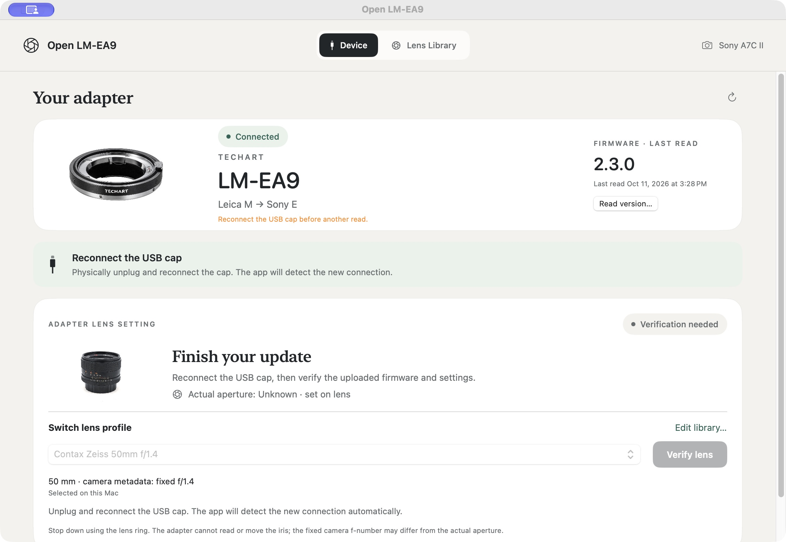
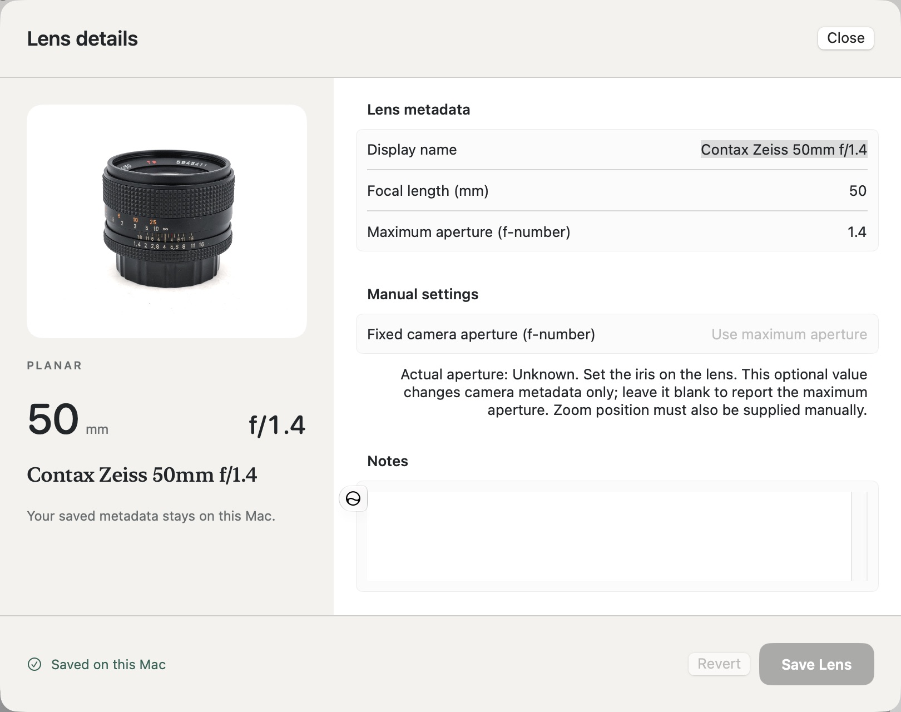

# Fixed aperture presentation and factory AF baseline

October 11, 2026. Implemented the owner's request for fixed numeric aperture
reporting, unknown physical aperture in the app, a modular factory-derived
motion baseline, documentation and a committed candidate. **No 2.4 hardware
upload or camera test occurred**. Reduced hunting remains a result to measure.

## Delivered behavior

App **0.7.0, build 10** labels the numeric value **camera metadata: fixed f/...**
and always shows **Actual aperture: Unknown · set on lens**. The editor calls
the optional override **Fixed camera aperture**, defaults a blank value to the
lens maximum and explains that the manual ring controls the iris. Existing
`currentAperture` libraries/profile-v1 remain compatible; no unknown wire
sentinel or sensed-aperture field is invented. Firmware already declares equal
range endpoints and its own current AV; the candidate retains that behavior
and ignores conflicting iris requests. A real f/8 request is now checked against
every generated prime/macro fixture without altering its fixed reply/range.

The existing Device dropdown, automatic descriptor/history refresh and primary
firmware-preserving profile action remain. Explicit AF install / CLI AF prepare
now select **2.4.0** through a separate resource/digest pin. Frozen 2.0–2.3
versions remain admitted and pass their unchanged digest checks. Backup/journal
schemas, protected flash rules and the stock recovery bundle are unchanged.

AF **2.4** replaces the 5 ms feedforward/boost servo with independently
implemented stock 1.8 motion semantics: speed staircase, incremental PID,
retained history, target crossing, Stop and callback divider/timeout. The pure
law and bounded hardware wrapper are separate modules. Foreground scheduling
uses the recovered nominal 60,008-cycle callback ratio at 48 MHz. Homing,
origin policy, braking, sticky faults and remaining protocol/optical differences
are explicit in the [design](../reverse-engineering/factory-af-baseline.md).

The prepared [50mm candidate](../../firmware/candidates/2.4.0/README.md) is 20,480
bytes, with its 256-byte profile at `0x9f00` and application end at `0xa000`.
The [build manifest](af-factory-build-manifest-2026-10-11.json) pins sources and
dependencies. Code/initialized data end at `0x9d60`, leaving 416 bytes before
the profile. Data/BSS occupy 2,816 bytes plus the existing reserved 8,192-byte
stack; reserved RAM ends at `0x20002b00`. This is static link layout, not a
measured stack high-water mark.

## Verification

- **7,323 production-controller comparisons** against original factory Thumb
  instructions pass. Thirteen controller fields, defined return values and
  final motor calls match under the supplied random/boundary/composed states.
  Changing the integral gain from 150 to 151 is rejected. The
  [oracle report](af-factory-oracle-2026-10-11.json) states emulation limits.
- **18 scripted wrapper scenarios**, under address/undefined-behavior sanitizers,
  pass: crossing, clock wrap, reversal/retarget, Stop before/at/after crossing,
  early/final sensor failure, missed-control gap, frozen clock, overtravel,
  final drift, reversed feedback, stall, timeout, dry mode and invalid initial positive/negative encoder values. Feedback is
  scripted; this is not a physics, electrical or optical-focus measurement.
- **11 production-main lifecycle scenarios and 18 hardening scenarios** pass
  with the factory backend. Existing legacy tests also pass. Legacy speed/dwell
  arrival cases are kept with the old backend; factory crossing is checked by
  the new suite. Real MMIO driver fault/startup checks and the new SysTick
  snapshot phase/pending/wrap/IRQ-preservation check pass.
- **49 Swift tests** pass: LensCore 7, DeviceKit 33, AppWorkflow 9. Variant
  parametrization includes 2.4 upload, changed-code rejection, reconnect
  verification, protected-row checks and journal integrity. An owner-declared
  f/4 survives encoding/readback without becoming a physical measurement.
- Seven seeded prime/macro profiles pass native-to-C corruption/frame/checksum
  checks for metadata and AF. The zoom still requires a manual focal selection.
  Native and Python 50mm preparation produce exactly the same candidate bytes.
- The release app/CLI build and local ad-hoc signature verification pass.
  Native UI inspection confirms the Device labels and editor explanation without
  changing local metadata or starting any device operation.

Reproduction from the repository root:

```sh
python3 scripts/build-firmware.py --variant factory-af
./scripts/swift-local.sh test
python3 scripts/test-firmware.py --af
tools/rea-analysis/venv/bin/python scripts/test-factory-af-oracle.py --output /new/evidence-directory
./scripts/build-macos-app.sh
```

The oracle uses the existing pinned [REA dependencies](../../research/stock-1.8/requirements.txt)
and refuses an existing output directory. Generated logs, libraries and local
builds stay ignored; public evidence contains no per-unit saved values or keys.
The machine-readable [milestone record](factory-af-baseline-2026-10-11.json)
contains source/digest links and exact qualification flags.

## UI observations and hardware boundary

The Device screenshot shows a **historical 2.3 read**, dated and explicitly
labeled last read, plus the pending reconnect/verification guard. It is not an
observation of current installed 2.3 firmware. The stock application's complete
slot was previously audited equal to the original; its strict native restore
transaction remains flagged for the post-camera saved-record change. No guard,
journal or blocked connection was bypassed. This milestone sends **zero USB
feature reports**; UI inventory reads descriptors/local state only.





Original stock 1.8 remains installed. Resolve its pending transaction review
and physically reconnect before the next device operation. Then upload/USB-verify
the new candidate before a matched loaded-lens AF-S test. The
[runbook](../af-s-test.md) records the comparison settings and stop conditions.
Factory motor timing, physical origin, loaded stability, less hunting, sharpness,
camera aperture-dial behavior, stopped-down AF and broader AF-C/video support
remain unqualified. The factory instruction match covers the motion law, not
whole-firmware or optical-performance parity.
