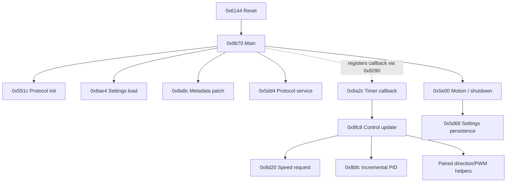

# Stock 1.8.0: bounded offline first pass

> Phase-2 follow-up: [factory AF and persistence dossier](stock-phase2.md). Correction: the general reply dispatcher is `0x58a4`; the first-pass `0x56cc` label refers to the aperture-coded focal/options menu. The historical inventory below is retained.

Research date: October 10, 2026 (America/New_York). No USB enumeration, reads,
reports, updater launch, camera interaction, or flashing was performed. Production
firmware/app sources, build outputs, distribution files, reconnect state, and the
separate audit report were not edited. This is static research, not hardware
qualification or a replacement-firmware implementation.

## Evidence and reproducibility

The recovered official application is 20,172 bytes (`0x4ecc`), SHA-256
`f4d616d2ae685775efff0eedbbbaec81d5c922a2f463bb630df83c41be13f564`.
Its release is **1.8.0**, not 0.1.8. Raw address = file offset + `0x5000`.
The stock image ends exclusively at `0x9ecc`.

REA snapshot: [morluto/rea, 5100a1a1](https://github.com/morluto/rea/tree/5100a1a1a56b810c8246b8c7ed19ff42c4d9dbe1),
package version 6.3.0. The immutable snapshot and its AGENTS.md were read; a
separate scratch copy was compiled. The reference C implementation is pinned to
[d52ed06c](https://github.com/weiziqian/E-mount-impl-on-Techart-EA9/tree/d52ed06cc449918f938e0695fbf29a0c4141f2b2).
See [the collection manifest](../../references/sources.json).

The real REA MCP interface was used: `open_binary`, `list_procedures`,
`list_segments`, `procedure_callees`, `read_function_instructions`,
`analyze_function`, and `close_binary`; actual schemas are preserved privately.
The final import reports **213 procedures, 268 resolved call edges, 6,825 unique
instruction addresses, and 27 targeted function dossiers**. Every recorded
instruction start also decodes in the independent ARMv6-M LLVM listing; this
is a decode-coverage check, not semantic equivalence. REA closed its target
successfully. See [procedure inventory](procedure-inventory.csv) and
[resolved call edges](resolved-calls.csv). Callback/table edges remain separately
reasoned, and the uncalled termination stub at `0x99c4` demonstrates why this is
not a complete function-discovery claim.
The [scripts and reproduction procedure](../../tools/rea-analysis/README.md)
record setup, import assumptions, commands, failed attempts and outputs.

Backend assessment:

| Provider | Snapshot interface and local finding |
| --- | --- |
| Ghidra | Read-only executable import into ephemeral projects; available after a local native decompiler build. Chosen backend. |
| Hopper | Commercial GUI provider, separate installation/license; not found in /Applications or on PATH during this pass. Not used. |
| IDA | Bring-your-own IDA/Hex-Rays plus ida-pro-mcp; attached legacy 1.4.0 or headless supervisor profiles. Not installed/configured for this pass. |
| Firmware tools | Binwalk/Unblob wrapper requires Linux-style prlimit and does not provide a raw Cortex-M flash profile. Not a suitable primary workflow for this bare-metal image. |

Ghidra [12.1.4 official release](https://github.com/NationalSecurityAgency/ghidra/releases/tag/Ghidra_12.1.4_build)
was downloaded and its published SHA-256 checked. Archive hash:
`ddac49f903da9d5bac833e5cc79395098b9c33cfd3279be5f31bd00387d2d4db`.
Its bundled native source built successfully as macOS arm64 `ghidra_opt`; resulting
`decompile` hash is `7434284fc5a6b46b3cb27ef2e8d3c4ea7f801ac1f0cca30e95eb27732c0c62f0`.
A first attempt selected the BFD-dependent console target `decomp_opt` and failed;
that is not the executable used by the Ghidra bridge. Node 26.5.0/npm 11.17.0
compiled REA. Existing Android Studio JBR 21.0.10 supplies Java without launching
that app. Homebrew JDK 26 failed on a macOS-rejected dependent library; no signing,
Gatekeeper, Java, or global configuration changes were made. Apple LLVM 21.0.0
provides the independent `thumbv6m-none-eabi` disassembly.

Final synthetic ELF SHA-256:
`55cc2eb5e45c426a795f72daca024a1e01605b803f4b502ac0f8f2af0cd14641`.
It retains every input flash byte, splits vectors/code/constants,
and adds the reset-derived SRAM initializer mirror plus BSS. It is an analysis
artifact, never a firmware candidate. Its symbols are analyst seeds, not stock
names. REA's automatic ELF language selection is **ARM:LE:32:v8**, not a strict
ARMv6-M profile; odd function symbols set Thumb context. Consequently the Ghidra
output is checked against raw bytes and ARMv6-M LLVM disassembly. The first import
missed callback-only routines; the second adds explicitly evidenced callback
pointers. Decompilation is not source recovery, and an inventory is not proof of
complete reachability. Raw reports and decompiled text remain private.

## Memory and startup

| Range/address | Observed purpose and evidence |
| --- | --- |
| `0x0000..0x3fff` | Unit bootloader code; separately saved backup hash verified. |
| `0x4000` | Loader upload metadata destination, distinct from stock app settings. |
| `0x4100..0x412b` | 44-byte stock settings source; copied by `0x8ae4`, written by `0x5d68`. Semantics only partially recovered. |
| `0x5000..0x50af` | 44 vector words. Four padding bytes precede first code at `0x50b4`. |
| `0x50b4..0x95f7` | Analysis code region, with interspersed literal pools; not every byte is executable. |
| `0x95f8..0x99d3` | Primarily constants/tables, also runtime init stub `0x99b4`, fini stub `0x99c4` and constructor/destructor pointers. The synthetic `.rodata` label is not proof that the whole range is data. |
| `0x95f8` | 91-entry message dispatch table for IDs 0..0x5a, per byte-checked upstream extractor. |
| `0x99d4..0x9ecb` | 1,272-byte initialized-data load image, including packet templates and motion state. |
| `0x20000000..0x200004f7` | Initialized RAM copied by reset at `0x6154..0x6160`. |
| `0x200004f8..0x200004ff` | Gap; reset copy/zero loops do not initialize these eight bytes. |
| `0x20000500..0x20000aaf` | 1,456-byte BSS zeroed by `0x6166..0x6170`. |
| `0x20002ab0` | Initial SP from vector 0. The apparent 8 KiB separation above BSS is not a measured stack high-water mark. |
| `0x20004000` | SRAM exclusive limit for the target SAMD21E17A, from device definition. |
| `0x41004400`, `0x60000000` | PORT APB and fast I/O views used in stock. |
| `0x42000800`, `0x42000c00` | SERCOM0 SPI and SERCOM1 E-mount UART. |
| `0x42002000`, `0x42002400`, `0x42003000` | TCC0 PWM, TCC1 timer, TC4 timer. |

Reset at `0x6144` copies data, clears BSS, writes VTOR=`0x5000` at `0x617a`,
configures bus/NVM/cache-related registers, calls `0x9540` (runtime initialization)
and then `0x8b70` (application main). Main calls board/init routines, protocol
initialization, encoder initialization, timer callback registration, drive stop,
settings load and boot metadata patching. Its final loop calls `0x5dd4` and
`0x5e00` repeatedly. The stock protocol initializer waits on camera timing inputs;
static startup order does not imply it reaches the main loop on a USB bench.

Non-default vectors (values shown with Thumb bit removed):

| Vector | IRQ | Handler |
| --- | --- | --- |
| Reset | — | `0x6144` |
| EIC | 4 | `0x7650` |
| NVMCTRL | 5 | `0x7a40` |
| DMAC | 6 | `0x7504` |
| SERCOM1 | 10 | `0x7df8` |
| TCC0 | 15 | `0x86cc` |
| TCC1 | 16 | `0x86e0` |
| TC4 | 19 | `0x8990` |

NMI, HardFault, SVCall, PendSV, SysTick and all other nonreserved peripheral
vectors point to `0x6140`, an infinite branch. Reserved core slots are zero.
In particular USB and ADC vectors are default, and there is no stock SysTick
scheduler established by this vector table. Exact inventory is generated privately.

## Annotated functions and confidence

Names below are descriptive analyst labels. **High** means the stated local
operation is verified in instructions and/or matching REA output; **medium**
means its larger semantic role still relies on caller/data interpretation.
No label claims dynamic testing or complete state-machine coverage.

| Address | Label / scope | Confidence | Evidence |
| --- | --- | --- | --- |
| `0x6144` | reset/copy/zero/VTOR/main | High | literals `0x61d4..0x6204`; vector 1 |
| `0x8b70` | initialization and two-service main loop | High | calls at `0x8b74..0x8bb8`; backward loop `0x8bba` |
| `0x51d4` | finalize/checksum/transmit frame | High | length `0x51ec`, terminator `0x51f2`, sum loop `0x51f8..0x520c`, send `0x5222` |
| `0x551c` | E-mount startup and packet-pointer setup | High / medium handshake interpretation | pin waits at `0x5544`, descriptor and packet RAM references |
| `0x56cc` | message dispatch | High | indexed dispatch through `0x95f8`, extractor interprets handlers |
| `0x567c` | focal-dependent response field ladder | Medium | upstream emount.c plus stock comparisons; units need camera validation |
| `0x5dd4` | foreground protocol-service fan-out | Medium | called every main-loop turn, state/record service callees |
| `0x5e00` | motion/status/shutdown foreground state machine | High local branches; medium complete semantics | gates `0x20000530`, `0x2000052c/d`; paired drive and park/ack/off sequence |
| `0x5d68` | settings persistence wrapper | High | address built as `0x82<<7`; buffer `0x20000494`, count `0x2c`; NVM helpers |
| `0x8ae4` | settings load | High | eleven words from `0x4100` to `0x20000494`; copies offset `0x26` to `0x20000680` |
| `0x8a8c` | boot-time response patch | High | immediate `0x18`, conversion `0x66b8`, RAM packets and call `0x567c` |
| `0x89a4` | SPI sample read | High operation / medium sensor interpretation | two receive bytes composed then shifted right 2; GPIO selection |
| `0x8c80` | sensor/motion initialization | High | calls sample reader with 1, seeds fields, sets base 4096 |
| `0x8cc0` | sensor difference to protocol position | High arithmetic / medium physical mapping | thresholds 8191/10000, wrap constant 16383, arithmetic shift 2 then +4096 |
| `0x8a2c` | periodic callback / divided control update | High | pointer at `0x8bd4` registered via `0x6090`; counter then call `0x8fc8` |
| `0x8fc8` | speed-feedback motor update | High | position delta, speed-request `0x8d20`, PID `0x8bfc`, signed paired outputs |
| `0x8bfc` | incremental PID and output floor/clamp | High arithmetic | error differences, accumulator, signed division, floor and symmetric limit |
| `0x8dd4` | requested-position/motion setup | Medium | caller passes 16-bit position from status packet; pending detailed bounds audit |
| `0x8e28` | drive stop/release routine | Medium electrical mode | called on shutdown/timeout; PWM/pin effects do not establish bridge wiring |
| `0x904c` | PWM initialization | High | period parameter 2560 into driver, followed by enable |
| `0x9070`, `0x9098` | PWM compare/pair update helpers | High registers / medium physical mapping | direct TCC0 register writes and paired calls |
| `0x8e88/0x8ed8`, `0x8f28/0x8f78` | signed direction output pairs | High control flow / medium motor topology | positive/negative branches from `0x8fc8`, pin mux and compare helpers |

The central verified call relationships are:

The dotted edge denotes callback registration, not a direct call. Interrupt
wrappers, scheduling and dispatch-table edges are omitted from this compact view.

## Packets, settings and motion findings

The upstream packet extractor was run against the verified recovered image. It
produced **20** reply/status templates and the 1,272-byte initializer; generated
C is byte-for-byte identical to the pinned upstream C. The extractor's opening
comment says 23, but its actual output for this image is 20. Message IDs are
01, 05, 06, 07, 08, 09, 0a, 0b, 0c, 0d, 10, 19, 1b, 28, 32, 34, 3d, 3f, 4c,
5a; 16 is handled without a reply. Some stored length fields are runtime
placeholders. Handlers also edit payloads (0c and echoed fields in 1b/34), so a
raw template scan is insufficient.

At `0x51d4`, checksum is sum(frame[1:length-3]) modulo 65536 (Python slice
notation), stored little-endian at length−3 and length−2. F0 and final 55 are
excluded. The routine writes only the low length byte; observed frames are at
most 210 bytes. That is an observation about these templates, not a generic
16-bit-length parser implementation or proof of incoming checksum validation.

At boot, `0x8a8c` rewrites bytes in status 05 and 06 and invokes the focal ladder.
At `0x8ae4`, settings offset `0x26` feeds `0x20000680`; `0x5d2c` scales that
halfword by ten into response fields. These dependencies mean neither the
loader's version metadata nor a single EXIF-looking byte is a general lens
profile block. An independent profile format must explicitly separate lens
identity/aperture/focal/optical fields from motion calibration.

The stock PID update is incremental: weighted first error difference, current
error and second difference are added to an accumulator, divided by a scale,
then given a nonzero magnitude floor and a symmetric clamp. The initializer at
flash `0x9e94` / RAM `0x200004c0` independently verifies coefficients
500/150/300, ceiling 1280, floor 200 and divisor 200. This PID block starts
just after the 44-byte persisted settings copy; it is not overwritten by that
copy. Exhaustive runtime-writer analysis remains open. The PWM
initialization uses 2560 period units; the reference reports approximately
18.75 kHz with the 48 MHz clock. Sensor sampling combines a two-byte SPI word
and shifts by two, consistent with 14-bit feedback. The stock wrap arithmetic
uses 16383 and asymmetric thresholds; do not silently substitute the replacement's
wrapped-delta algorithm while claiming equivalent stock behavior.

A gated block at `0x5e72` drives both negative pairs at 800, waits 300, stops,
waits 500, samples position and schedules settings persistence. The gate is
BSS byte `0x20000530`, initially zero. This proves the block and gate; it does
not prove a power-on homing sequence. Upstream main.c explicitly retracts its
older claim that stock homes at power-on. Exact arming conditions and mechanical
end-stop safety remain open. Callback `0x8a2c` invokes the speed controller when
the old divider byte equals 10 and then resets it: an 11-callback cadence from
zero, not ten. It also stops motion when a separate counter reaches 300; these
are callback counts, not yet verified milliseconds. `0x8dd4` converts a signed
protocol target using `(target−4096)*4` narrowed to 16 bits and selects direction;
no physical travel clamp is established inside that routine.

No stock ADC measurement/calibration path was established in this pass. The
replacement's vdd.c measures SCALEDIOVCC and imports ADC fuse calibration; it is
not evidence that stock does so. The stock literal `0x00806024` at `0x8228` is
used by DFLL clock calibration. Neither logic-supply ADC readings nor static
PWM analysis establish motor-rail voltage/current, lens load, travel limits or
A7C II autofocus stability.

## Loader separation and management feasibility

Independent inspection of the saved bootloader confirms the state-2 branch at
`0x259a..0x25ba`: write the received 64 bytes at the current pointer, echo them,
increment pointer by 64, rearm reception. It bypasses the command-magic tests.
START at `0x2634..0x2652` uses RX+6 as a 64-byte metadata source (six bytes beyond
the nominal 64-byte report), initializes destination `0x5000`, and enters state
2. No length/end/disarm branch appears in this dispatcher. PA23 testing at
`0x26cc..0x26ce` selects the USB loop for high and the app handoff for low.
These are offline observations; they reinforce the hardware hold.

The stock application USB vector is the default trap. The cap selects the loader
before app startup, so an application-only management service will not become
reachable merely by adding a parser to the app. A future design needs a proven
entry route, USB ownership/initialization, explicitly bounded writes and a
versioned storage policy. Calling bootloader internals as a stable API is not
established. Upper-flash duplicate application bytes are not a qualified recovery
slot. This pass did not independently complete the entire row-RMW helper audit;
its previously reported 256-byte erase behavior must remain separately sourced.

## Implementation decisions this evidence supports

1. **Investigate a minimal stock metadata patch first.** Work from a manifest of
   every affected initializer byte, boot-time overwrite, runtime setter and
   checksum effect. Preserve stock motion/control timing while testing lens
   declarations. This is a research option, not a tested patch or permission to
   flash. Focal/aperture/optical consistency and A7C II behavior remain gates.
2. **Keep the metadata-only C candidate as a protocol qualification tool.** Its
   metadata_main.c releases the motor and consumes focus commands without
   executing them. Its separately defined 256-byte CRC-checked `EA9LENS1` profile
   at `0xa000` applies focal length, a fixed declared aperture from the user
   setting, and 64 name bytes in response 3f. This is our format, not a stock
   storage format; stock ends at `0x9ecc`, but that alone does not qualify
   `0xa000` as universally unused across firmware versions. It is not stock autofocus with configurable metadata. Its
   SysTick scheduling and rebuilt responder also differ from stock.
3. **Separate management from camera/motor service.** First settle cap entry and
   safe storage/update transactions. Do not reuse `0x4100` for a new profile or
   assume all erased-looking space is free; stock actively owns that region.
4. **Delay a full rewrite/language choice until interface invariants are known.**
   A Rust architecture can isolate packet parsing, profile encoding and bounded
   motion commands, but language choice does not recover optical semantics,
   interrupt timing, calibration or a safe management entry path.
5. **Next bounded analysis:** recover all settings fields/readers/writers;
   exhaust callback/table edges; audit incoming record bounds/checksums and
   motion-limit/park gates; identify the exact timer period and control cadence.
   Then produce a byte-level patch plan with rollback prerequisites and a
   hardware qualification protocol in the parent workflow.

The first milestone is a reproducible offline provider pipeline, verified
startup/storage/packet boundaries and a useful motion call-chain map. Complete
firmware reconstruction, sensor calibration, every dispatch case, runtime safety,
and hardware compatibility remain outside this milestone.

## Local artifact index

Public notes contain addresses and interpretations, not raw tables or unit identity.
All private reports are under `references/private/rea-analysis/`: `provenance.json`,
`elf-validation.json`, `inventory.json`, `coverage.json`, `mcp-catalog.json`,
`procedures.json`, `segments.json`, `graph/`, `function-*.json`, `callgraph.json`,
`callgraph.dot`, and packet-extraction evidence. `first-import/` preserves the
initial import and its missed-callback evidence. Failed JDK/tool attempts remain
labelled separately. Tool installations and local reproduction scripts are under
`tools/rea-analysis/`, intentionally ignored by the project. Run `summarize.py`
after the MCP session to rebuild the public address-only CSVs and private graph.

Validation: raw SHA-256 rechecked, synthetic ELF flash sections reconstructed
byte-for-byte against all 20,172 original bytes, generated packet C compared
byte-for-byte to upstream, all 213 procedure graph/instruction responses checked
for successful results and matching input digest, script syntax checks passed,
and explicit REA target close succeeded. No production tests were needed because
production code was not changed.
