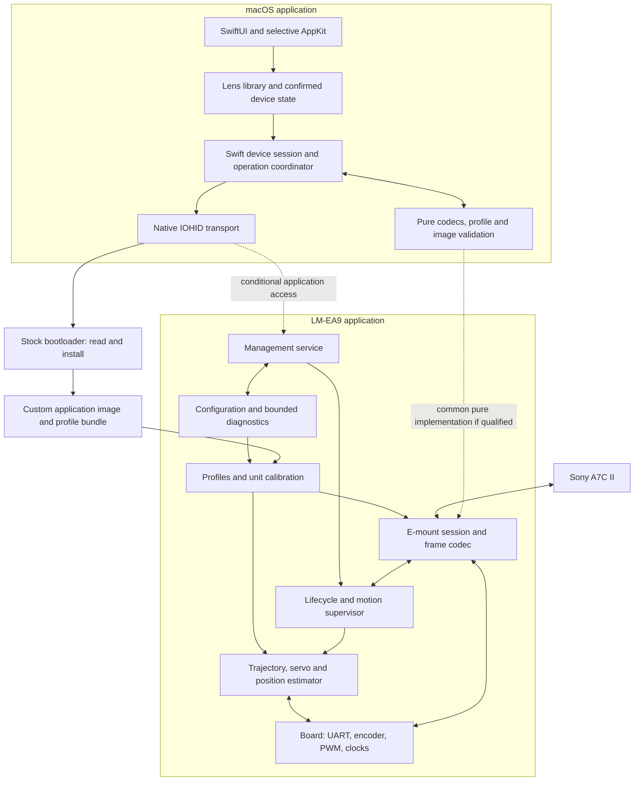

# Recommended LM-EA9 system design

## Updated working recommendation — October 14, 2026

The owner subsequently authorized this upstream C direction for the
[3.2 startup/handshake milestone](evidence/upstream-32-startup-diagnostic-2026-10-15.md),
with hardware flashing deferred. That offline candidate and the native Swift
host are now implemented; A7C II acceptance remains unqualified.

Use the pinned upstream **C firmware as the development foundation**, retain the
native SwiftUI/AppKit application and Swift IOHID/update service, and keep the
management contract independent of language. Defer a Rust firmware port and a
shared Rust host core until there is a camera-qualified baseline and a concrete
benefit to justify the added boundaries. Every firmware candidate flashed in
this project has been C; Rust is not implicated in these failures.

This recommendation answers the owner's question about adopting upstream
instead of continuing the Rust plan. It does not claim upstream is qualified:
the direct 3.1 build also failed this A7C II check, showing aperture `--` and a
blocked shutter with normal shutdown. See [the failure and five-case startup
investigation](evidence/upstream-31-camera-failure-2026-10-14.md).

The next firmware milestone is startup/handshake, nominal lens information,
MF capture and shutdown on this body, then bounded AF-S and saved-photo checks.
Only after that baseline succeeds should metadata persistence or controller
changes be added, one independently testable step at a time. Preserve the
factory REA findings and previous modular work as comparison evidence; do not
merge reconstructed behavior wholesale into the first baseline. Keep the
existing backed-up native upload/reconnect/verification service rather than
replacing it with an unreviewed flashing path. No new image or flash follows
from this recommendation alone.

The sections below retain the **earlier October 10 Rust-first research
recommendation and its qualification gates**, rather than the current working
direction above.

> Current follow-up (prototype 0.3.0): the [USB metadata milestone](usb-metadata-milestone.md) adds a reviewed, bounded application upload, mandatory physical reconnect and full byte verification. Its first firmware candidate uses the reference C implementation with motor motion disabled. [Actual measurements](evidence/usb-metadata-milestone-2026-10-10.md) distinguish stock upload qualification, custom read-back and pending camera checks. The material below records the earlier research/prototype stage.

Implementation follow-up: the user authorized the
[native Mac prototype](macos-prototype.md), now using SwiftUI/AppKit, native Swift
IOHID, local metadata and verified read-only backup. The current host core is
pure Swift because a shared Rust codec has no established firmware contract to
reuse yet. This adopts the recommended host direction without freezing the
production firmware language or management-service design.

October 10, 2026. Synthesis of three parallel audits:
[firmware](audits/firmware-options.md),
[host protocol](audits/host-protocol-options.md), and
[macOS](audits/macos-options.md). The requirements remain in
[product-direction.md](product-direction.md).

Follow-up: the [connected-device USB-cap investigation](usb-cap-investigation.md)
now confirms native macOS CHECK/READ and the installed 1.8.0 application. It also
finds that the stock bootloader's USB mode stays in the bootloader, with no
supported application-launch path in its inspected handlers. Application
management needs a qualified entry bridge or alternate cap/mode arrangement.

The [read-only follow-up](usb-cap-followup.md) now measures ATSAMD21E17A revision
D, 128 KiB flash, clear security/boot protection and unlocked regions. Two full
flash backups match; PA23 reads high as an input with a pull-down in cap mode.
Independent recovery and physical electrical checks remain pending. The
[entry proposal](management-entry-design.md) favors a small launch extension
after recovery qualification and records the handoff requirements.

The user subsequently reported an unplug event and USB-only access. A matching
device re-enumerated with a new registry entry; a complete flash read and the
qualified snapshots still match. Continue host/offline firmware prototypes
within the [USB-only boundary](usb-only-next-steps.md); independent restoration
and electrical measurements remain unqualified.

## Recommended direction

**Prototype Rust `no_std` firmware, a native SwiftUI/AppKit macOS app, and a
language-neutral management protocol.** Use a small shared Rust library for
pure codecs and validation if that reuse earns its integration cost. Swift
owns the OS device connection and application lifecycle. Preserve the original
bootloader and retain modular C as the firmware fallback.

This is the preferred design to qualify, not a declaration that the research
or hardware validation is complete. Select the production stack after the
prototype gates below. No adapter was accessed, toolchain installed, updater
executed, or firmware flashed during these audits.

| Layer | Recommendation | Reason and qualification |
| --- | --- | --- |
| Firmware language | Rust `no_std`; C fallback | Strong fit for validated parsing and explicit state/ownership; complete EA9 memory/timing still unproven. C has the collected working hardware reference. |
| Scheduling | Short interrupts, periodic motion step, bounded event/state machines | Matches small MCU and camera timing; keep a runtime upgrade optional. |
| Hardware boundary | Small EA9 board package using a pinned PAC/HAL and audited register operations | Preserve actual pin/clock/output behavior; generic board defaults are unsuitable. |
| Host management contract | Versioned bounded binary envelope, restricted CBOR payloads and CDDL schema | Independent of implementation language; TLV remains the footprint fallback. |
| Host connection | Native Swift IOHID adapter, initially the existing bootloader protocol | Small platform boundary with explicit report and session ownership. |
| Application USB service | Vendor HID, conditional on a qualified entry bridge or alternate cap/mode path | Suitable for small settings/diagnostic messages; the inspected stock USB boot path does not launch the application. |
| macOS UI | SwiftUI with selective AppKit | Best current fit for native Mac interaction, file workflows and accessibility. |
| Shared host/device logic | Narrow synchronous Rust codec/profile/image library, conditional on demonstrated benefit | Avoid inconsistent validation while containing FFI and concurrency complexity. |
| Configuration | Image-embedded profile bundle first; transactional persistent banks when supported | Fits the evidenced uploader; dedicated writes need a proven service and erase boundaries. |
| Updates | Recognized release package, stock bootloader, backup and complete read-back | Keeps the existing recovery channel; no unsupported rollback/resume promise. |

Rust's official target covers Cortex-M0+ bare-metal execution; the atsamd-rs
project supplies SAMD21 support. Neither establishes a working EA9 build.
[Rust target](https://doc.rust-lang.org/rustc/platform-support/thumbv6m-none-eabi.html),
[atsamd-rs](https://github.com/atsamd-rs/atsamd).
The native UI judgment follows the Mac-only product goal, rather than a
single-language preference. SwiftUI can integrate AppKit views through
[NSViewRepresentable](https://developer.apple.com/documentation/swiftui/nsviewrepresentable).

## Architecture and ownership

The diagram's dashed USB path is a proposed capability. Stock bootloader CHECK
and READ have now been repeated on the user's device; installation and an
application USB service have not. Camera and USB-cap sessions should be separate
until hardware evidence demonstrates otherwise.

One module owns each resource. The board package owns peripheral access. The
motion axis owns motor commands. The lifecycle supervisor admits or rejects
camera/management requests according to operating mode. The camera session owns
protocol completion events; it reports arrival from motion evidence, not from
having queued a command. Activate a profile as a consistent validated snapshot,
so status messages and the controller cannot use different lens descriptions.

Keep the E-mount codec, focus models, profile validation, management schema and
configuration-record logic independent of register code. Test them on the Mac
using the same wire vectors whether the final implementation is Rust or C.
Isolate firmware `unsafe`, DMA/interrupt handoffs and any FFI within small
reviewable boundaries.

## Firmware execution and autofocus

The reference targets 48 MHz SAMD21E17A with 128 KiB flash and 16 KiB SRAM.
The application starts at `0x5000`, leaving 108 KiB above the bootloader before
configuration/log reservations. Confirm this physical unit rather than using
a larger development-board map. Its replacement firmware uses **SysTick** for
milliseconds; the earlier TC4 summary has been corrected.
[Reference linker](../references/upstream/weiziqian/E-mount-impl-on-Techart-EA9/src/ea9.ld),
[delay implementation](../references/upstream/weiziqian/E-mount-impl-on-Techart-EA9/src/delay.c).

Start with the reference's 750 kbaud transport and 5 ms control cadence, then
measure timing on the unit. A UART byte occupies about 13.33 microseconds;
210 bytes take 2.8 ms on the wire. Those are transmission times, not execution
measurements. Capture CS/VD edges, use bounded RX buffers with explicit overflow
handling, validate length/checksum/terminator, and separate trailing window
bytes before interpreting commands. Consider interrupt-driven TX or DMA when
polling materially affects measured control jitter. Last-byte UART completion
and CS release timing remain explicit responsibilities.

Use state machines for startup, homing, ready, motion, scan/drive, stopping,
parking, management and fault handling. Specify abort priority, relative-command
ordering, retargeting and event semantics; a single latest-target variable does
not preserve every command. Every ISR and dispatcher step has bounded work.
Choose a general executor or RTOS only when a demonstrated concurrency need
justifies its RAM and timing cost. RTIC, Embassy and statically allocated
FreeRTOS are viable alternatives, not unsupported technologies.

Measure encoder scale/polarity/noise, load-dependent drive response, friction,
stopping distance, relaxation, travel and fault behavior. Keep motor-off fault
handling and watchdog/reset behavior board-validated. An endless panic/default
handler must not leave PWM running. Use a bounded RAM trace, dropped-record
counters and controlled persistent fault records; avoid routine frame-by-frame
flash logging.

The Sony body performs image-based focus estimation and issues requests. Our
firmware's autofocus quality comes from correct camera dialogue, motion,
completion reports, calibration and consistent optical descriptions. Metadata,
optical calibration and unit-specific mechanism calibration are separate records
with provenance. Unknown calibration stays unknown. Zoom, manual aperture and
prefocus settings cannot be discovered through the passive adapter.

## Host protocol and persistence

Maintain three separate specifications: Sony E-mount semantics, the existing
bootloader exchange, and our versioned management contract. Firmware version,
protocol version, schema revision, installed image digest, profile generation
and camera-facing identity are distinct fields.

For management messages, specify a fixed envelope with version, operation,
session/request identity, bounded length, integrity and bounded fragmentation.
Prefer a restricted CBOR profile: explicit integer units and keys, bounded text
and bytes, shallow arrays/maps, definite lengths, no duplicate keys or unsupported
tags/floats. CDDL and golden vectors own the contract; language struct layouts
do not. Measure its target codec against minimal TLV before freezing encoding
and size limits. [CBOR](https://www.rfc-editor.org/rfc/rfc8949.html),
[CDDL](https://www.rfc-editor.org/info/rfc8610/).

Operations should cover identity/capabilities, current state, bounded library
reads, begin/write/validate/commit/abort/query configuration transactions,
profile selection, diagnostics and update coordination. Mutations carry an
expected generation and explicit transaction identity. Duplicate chunks/commit
requests must be idempotent; after a lost response, query committed state rather
than assume failure. Capability discovery must accurately distinguish legacy
apply-by-image from dedicated settings writes.

**Application USB entry is the central architecture gate.** The actual
bootloader's PA23-high USB branch remains in an infinite loop; the inspected
report/control handlers provide no supported application-launch path. Native
CHECK and READ work, but a USB driver in the application cannot bypass this
entry barrier. See [the investigation](usb-cap-investigation.md). Qualify cap
wiring/mode alternatives or a minimal launch bridge before promising that
endpoint. A bootloader extension needs its own recovery evidence and explicit
scope; it has not been adopted or implemented here.

The first supported integration can personalize a recognized custom release's
reserved profile section and upload it. This requires no compiler on the user's
Mac. Preload a compact catalog for the supplied lenses where capacity allows;
test any camera control sequence for selecting profiles as a separate A7C II
feature. Do not claim a RAM selection persists after power loss unless it does.

When dedicated writes become reachable, use row-aligned A/B configuration banks,
generation/length/CRC, and a separately written commit record. Validate and
read back the inactive bank before committing; retain the previous valid bank.
Validate power cuts at every erase/program boundary. Reserve code, config,
selection journal, logs and `.noinit` state explicitly in the linker. Freeze
addresses only after measuring profile sizes and the bootloader's entire erase/
write footprint. Main-array flash stalls make persistence during camera/motor
deadlines unsuitable without additional measured evidence.

Configuration commit behavior and firmware installation are different guarantees.
The stock loader streams an application without on-device atomic swap, demonstrated
resume or rollback. The pinned uploader's inclusive loop sends `limit + 64`
bytes; for the 20,172-byte stock image that is a calculated 20,544-byte span,
conditionally `[0x5000, 0xA040)`. Confirm actual transfer/erase behavior before
depending on any supposedly preserved partition.
[Uploader](../references/upstream/weiziqian/E-mount-impl-on-Techart-EA9/tools/ea9flash.py).

## macOS app and shared core

Build native presentation and a Swift device-operation layer. Keep a dedicated
IOHID callback/queue boundary, copy report data into owned buffers, and normalize
report IDs once. Swift owns discovery, device selection, open/close, hotplug,
timeouts, sleep/wake and reconnect generations. A Rust shared library initially
handles synchronous pure functions only: profiles, wire bytes and image/config
validation. Test its ownership/error/panic boundary and required architecture
slices before adding broader bindings. Avoid duplicate Swift and Rust transport
owners.

Reserve an **entire device transaction**, not just individual report calls.
Swift actors can interleave work at `await`, so actor isolation alone does not
serialize CHECK/READ/install sessions. Legacy READ responses do not echo an
address and upload ACKs have no chunk sequence; an ambiguous timeout requires
tested resynchronization rather than blind retries.
[Swift actor semantics](https://github.com/swiftlang/swift-evolution/blob/main/proposals/0306-actors.md).

Use a conventional Lens Library, Device and Diagnostics layout. Normal users
choose a lens, edit known metadata, connect in the supported mode, apply and
see a meaningful result. The zoom gets explicit active focal length; the macro
gets a manual reference setting. Keep optical tables/controller tuning in
advanced views. The app distinguishes saved locally, pending, read back, and
camera-validated state without exposing wire details to ordinary users.

Store versioned local profile documents with atomic file replacement, explicit
IDs/revisions, import/export and migrations. Backups and diagnostic evidence
have their own store. A cloud service or database is not needed for the current
small personal lens library. Provide keyboard/VoiceOver paths and readable
diagnostic summaries alongside plots.

Prefer direct distribution of a signed/notarized app; choose the minimum macOS
version and distribution channel before packaging prototypes. Validate USB
access on the intended signed build. Release packages should bind hardware
compatibility, code identity, config location/schema and permitted upload span.
The host should verify artifact origin and the personalized image, then compare
installed bytes. Host signature verification does not add secure boot to the
retained loader.

## Alternatives and decision rules

| Alternative | When it would become preferable |
| --- | --- |
| Modular C firmware | Rust fails actual resource/timing/driver/debug gates or requires substantially more custom infrastructure. Interfaces and fixtures remain the same. |
| Restrained C++ firmware | Strong team expertise and a demonstrated abstraction/maintenance gain over C or Rust. |
| RTIC / Embassy | Measured coordination benefit with acceptable lock/poll latency and memory use. |
| FreeRTOS / Zephyr | A concrete feature requires their services and the complete board build fits deadlines/memory. |
| Pure Swift host core | Shared Rust adds more build/FFI maintenance than useful validation reuse. |
| egui/eframe | Cross-platform or engineering-tool needs dominate and an actual Mac accessibility/interaction prototype passes. |
| Tauri | Web UI expertise/reuse or broader platform delivery becomes a requirement worth the additional web/native boundary. |
| Qt | Team expertise or cross-platform desktop needs justify framework deployment and module licensing. |
| TLV / Protobuf | TLV wins measured footprint/simplicity, or Protobuf tooling materially simplifies the maintained cross-language contract. |
| CDC / bulk USB | Measured debugging or trace-throughput needs justify another application transport, after reachability is proved. |

The audits include broader options and why managed embedded runtimes, generic
RPC stacks, filesystem-based settings and a new bootloader are not leading
choices for the evidenced requirements. These are practical rankings, not
language/toolkit performance measurements.

## Next work and production selection gates

1. **Read-only hardware evidence, partly complete:** descriptors, CHECK, exact
   chip/capacity/protection, user fuses/calibration and complete main-flash
   backups are captured. A full read and qualified snapshots after the reported
   unplug/re-enumeration match. Still establish cap wiring/levels, independent
   recovery, and stock A7C II traffic/focus results. Current equipment is USB
   only; reset/supply timing was not instrumented.
2. **Offline shared contracts:** replay all 3,456 validated historical frames,
   corrupted/truncated/tail cases and management/config vectors. Define profile
   schema, release-image format and version/capability rules independently of
   the selected language.
3. **Comparable firmware prototypes:** minimal C and Rust builds with correct
   vectors/board map, then motor-disabled handshake. Measure full linked flash,
   RAM/stack, ISR masking, UART loss, CS timing, control jitter and fault paths.
   A proposed initial gate is at least 25% SRAM headroom after worst-case stack;
   report this as a target, not an existing result.
4. **Native app prototype:** offline editor and scripted fake transport, followed
   by a read-only IOHID build. Test transaction exclusivity, unplug/late reports,
   keyboard/VoiceOver, signing and clean-machine operation. Qualify narrow FFI
   only if it pays for itself.
5. **Configuration-access decision:** qualify an application entry bridge or
   alternate cap/mode path against the stock bootloader barrier, establish
   erase/padding behavior, then choose the settings backend. Perform simulated
   and controlled power-loss tests before advertising transactions.
6. **Motion and optics:** supervised bounded movement, then the 50 mm prime,
   repeated center/edge/distance tests, other lenses, macro/zoom workflow, AF-C
   and tracking. Video support requires separate evidence. Compare image results
   and faults, not just apparent motor speed.
7. **Record the production decision:** select Rust if its complete prototype
   meets the gates; otherwise choose modular C. Finalize transport/schema
   bindings and partitions from measurements, then implement/package the product.

The architecture can be adopted as the design direction now. The stack,
on-device USB service, persistence guarantees and compatibility claims become
production commitments only when their evidence passes these gates.
