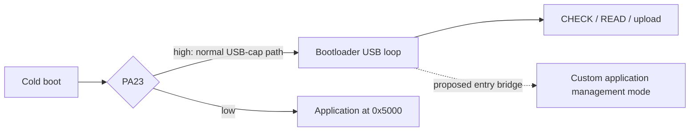

# USB-cap access investigation

October 10, 2026. Static analysis of the saved official macOS updater and
official application, followed by **identification, CHECK and flash READ only**
on the user's connected LM-EA9. No updater was launched, START/DATA sent, reset
requested, GPIO driven, or custom firmware executed.

Latest: [the read-only follow-up](usb-cap-followup.md) confirms the exact chip,
capacity, protection state, complete main-flash backup and PA23 digital state.
It also supplies a [management-entry proposal](management-entry-design.md).
The measurements below describe the initial investigation; its then-pending
memory checks have since been completed in the follow-up.

## Result and design implication

**The cap provides a working native macOS bootloader connection. It does not
provide a supported entry path into a custom application in the inspected
bootloader.** Adding an application USB driver alone will not make that service
reachable through the unchanged cap and bootloader.

The captured bootloader samples PA23 during startup. Low selects the
application at `0x5000`; high selects USB initialization and an infinite wait
loop. Its inspected report dispatcher implements CHECK, START/upload and READ,
with no application-launch command. Its inspected HID control handler supplies
no alternate application-entry route. These are conclusions from the actual
dump's control flow, rather than just absence of a command in the Python
uploader. They do not rule out faults, undocumented electrical behavior, or a
different bootloader revision on another unit.



The full product's management service therefore needs an explicit entry design:
a qualified bootloader launch bridge, or a measured alternate cap/mode path.
Until then, the supported integration is backup/read-back and installation of
a recognized custom application image containing profiles. Dedicated settings
writes and application diagnostics remain unavailable through the stock service.

## Hardware checks completed

The [machine-readable evidence](evidence/usb-cap-readonly-2026-10-10.json)
contains hashes, command counts, report layout and limitations. Raw USB identity,
session transcripts and binary dumps are local, Git-ignored evidence under
`references/private/connected-device-2026-10-10/`.

| Check | Actual result on this unit |
| --- | --- |
| USB identification | One `TECHART` / `LM-EA9`, VID:PID `0483:575A`, USB full-speed 12 Mbit/s; serial string is present |
| Native macOS HID | IOHID opens the device without the official app or a custom driver |
| Report descriptor | Vendor usage page `0xFFFF`, usage 1; unnumbered 64-byte input/output, 4-byte feature report |
| CHECK | Six successful queries report `1.8.0`; input callback report ID is zero |
| Application vectors | At `0x5000`, SP `0x20002AB0`, reset vector `0x6145`; match the cached image |
| Application bytes | Two identical 20,224-byte reads; all 20,172 cached firmware bytes match exactly; the extra 52 bytes are zero |
| Bootloader | Two identical reads of `[0x0000, 0x5000)`; reset vector `0x012D`, USB IRQ vector `0x2505` |
| Operations performed | 1,279 matched request/reply exchanges: 6 CHECK and 1,273 READ; all transmitted reports were 64 bytes |
| Official updater process | Not running when checked; it was not launched for this investigation |

Installed application SHA-256, excluding the 52 read-padding bytes:

```
f4d616d2ae685775efff0eedbbbaec81d5c922a2f463bb630df83c41be13f564
```

Bootloader-region SHA-256, including its metadata/padding:

```
e745faafe7f4896f0c86ddd30f6a1032131710566e3e3c223fa0768cb48d1e5c
```

These establish this connected adapter's installed application, replacing the
earlier cache-only version uncertainty. USB `bcdDevice=0x0200` is a separate
descriptor value; it does not mean the installed firmware is 2.0.0. CHECK's
triplet identifies the version declared to the loader, not the bootloader build.

This is **not a complete flash/fuse recovery backup**. Reads covered the
bootloader region and known stock application span. Upper flash, user-row fuses,
chip identification registers, physical wiring and recovery have not been read
or measured.

## Official macOS updater analysis

The saved `TECHART_Update.app` is an Intel x86_64 Swift/AppKit executable with
usable function symbols. `otool`, `nm` and Swift demangling were used without
executing it. Full extracted text is private under
`references/private/techart/updater-analysis/`.

| Binary location | Finding |
| --- | --- |
| `ViewController` initializer, `0x10000B4EC–0x10000B523` | Initializes `check_tab` and `start_tab` from static Swift arrays |
| Static arrays at `0x100024340` and `0x100024370` | Count 6 with `95 27 68 18 02 02`; count 9 with `95 27 68 18 01 01` and a default version triplet |
| `RFDevice.write`, `0x10000DF10` | Uses native IOHID output-report transfers; sends the supplied Data length |
| SetReport call, `0x10000E1A7–0x10000E1BB` | Report type 1/output, API report-ID argument **2**, payload pointer and Data length |
| Input registration, `0x1000190CF` | Receives reports through `IOHIDDeviceRegisterInputReportCallback` |
| Image padding, `0x100004272–0x1000042D0` | Pads to `(length // 1024) * 1024 + 1024` bytes |
| Chunk flow, `0x100006419–0x100006648` | Sends 64-byte slices, advances position by 64, and stops when position is at least the padded Data length |

The API ID-2 argument is an updater implementation quirk; the observed
descriptor contains no Report ID item. Our descriptor-consistent ID-zero,
64-byte output requests and ID-zero input callbacks worked. Do not prepend
Linux hidraw's zero byte to the native payload, or infer a numbered report
from that updater constant.

The updater's short CHECK/START arrays differ from the padded reports used by
the reference uploader and this probe. Native 64-byte CHECK/READ is now measured;
no short-report experiment was needed.

For this stock image the Mac app's calculated padded length is **20,480 bytes**.
The pinned Python uploader's inclusive loop instead calculates **20,544 bytes**
sent. Both are static calculations, not measurements of an update or its erase
footprint. The Mac app contains no literal `95 27 68 18 03 03` READ template;
the successful READ implementation came from the collected reference and was
confirmed on this adapter. No application-launch operation was found in the
inspected updater paths. The bootloader dump is the stronger entry-path evidence.

## Actual bootloader control flow

Linear Thumb disassembly was generated with an analysis-only ELF wrapper and
Xcode's LLVM disassembler. Data regions also decode as instructions; the
conclusions below follow reachable reset/main/handler paths and literal values,
not a count of disassembly matches. Addresses are flash addresses.

| Address | Recovered behavior |
| --- | --- |
| `0x012C` | Reset initializes RAM, sets vector base zero, and calls system initialization and main at `0x269C` |
| `0x0330–0x0352` | Configures PA23 as an input with input/pull enabled, output latch low: a pull-down at startup |
| `0x26B4–0x26CC` | Samples Port A using DIR/OUT/IN and tests bit 23 by shifting it into the sign bit |
| `0x26CE`, `0x26F2–0x26F4` | Low bit branches to the application handoff at `0x2510` |
| `0x2510–0x2524` | Loads MSP from `0x5000`, sets VTOR to `0x5000`, calls the reset vector at `0x5004` |
| `0x26D0–0x26EE` | High bit initializes USB, registers the OUT callback at `0x257C`, and queues receive |
| `0x26F0` | Branches to itself; no main-loop recheck of PA23 or automatic application launch |
| `0x257C–0x2680` | Upload state writes sequential chunks; otherwise checks the magic and command pairs 01/01, 02/02, 03/03 |
| `0x2626–0x2654` | START writes metadata through the pointer initially set to `0x4000`, then sets application write position `0x5000` and enters upload state |
| `0x2656–0x267E` | CHECK copies 16 bytes from `0x4000` into reply offset 6; only the first three have an established version meaning |
| `0x25EC–0x2624` | READ copies 64 bytes from the supplied little-endian address into the reply, with no address echo/header |

PA23's low/high selection is strong static evidence. The cap normally selecting
high follows from that code plus the observed working USB branch. Its actual
voltage, source impedance and contact routing have **not** been measured.
The PORT A input is at `0x41004420`, with the fast IOBUS alias used for DIR/OUT.
Microchip's [memory map](https://onlinedocs.microchip.com/oxy/GUID-22527069-B4D6-49B9-BACC-3AF1C52EB48C-en-US-21/GUID-BFF407FF-FE62-4CC6-B902-8DFA87AA8826.html)
and the saved family datasheet support the register interpretation.

The descriptor's feature report is not evidence of a hidden management channel.
In the inspected HID class handler at `0x2764`, device-to-host class requests
are rejected; there is no supported GET_REPORT branch. The SET_REPORT path has
a separate optional callback, but startup registers only the OUT endpoint
callback. No feature command was guessed or sent. The sole literal reference
to the application-jump function is the low-PA23 startup path; this supports the
entry conclusion but is not, by itself, a complete control-flow proof.

Bootloader USB register accesses target the SAM D21 USB peripheral at
`0x41005000`, supporting the family identification. The exact die/revision and
fuses remain unqueried. The 128/16 KiB map is still the reference target map.

## Recovered official application

The whole cached application is now matched to installed bytes. Its USB IRQ
vector, table index 23, points to `0x6140`, an infinite default-handler branch.
The only recovered USB-peripheral-base literal is in generic early startup;
that register access is not a USB service. Board setup at `0x6644–0x6658` later
makes PA23 an output driven low, matching the collected C reconstruction.

A new application must recognize a USB management mode **before** applying that
camera GPIO initialization. Keep motor outputs disabled and avoid driving
PA23 against a cap signal. Reinitialize USB clocks, pins, descriptors, interrupts
and ownership deliberately after any future handoff. The existing application
behavior is not a suitable USB initialization template.

## Remaining read-only hardware checks

| Check | Method and evidence needed | Decision it informs |
| --- | --- | --- |
| Cold-boot repeatability | User disconnects/reconnects the same cap; repeat inventory, CHECK and bounded reads; compare identity fields and hashes | Confirms the observations survive a power cycle rather than only the current session |
| Cap contact routing | With power removed, inspect the PCB and measure continuity from cap contacts to USB data, ground, supply and PA23 paths | Determines whether an alternate cap can select application mode while retaining USB wiring |
| Mode levels | High-impedance measurement of PA23 during USB cold boot and camera cold boot; record level/polarity, timing and relevant pull network | Confirms the physical strap and whether it can be changed without output contention |
| USB electrical path | Confirm D−/D+ routing to PA24/PA25 and USB-powered logic supply/reset behavior | Qualifies wiring/power for a custom USB device service; do not assume a development-board VBUS circuit |
| MCU/protection identity | Read chip markings; qualify DSU identity, NVM parameters and user-row/BOOTPROT/security reads through a documented memory window or a separately planned debug connection | Establishes actual memory map and whether a minimal bootloader change is possible |
| Full recovery evidence | After confirming capacity, repeat a complete flash/user-row read with hashes and document SWD pads/probe access | Provides complete source material for a later recovery experiment; reading a backup does not prove recovery works |

Microchip's [SAM D21 USB application note](https://ww1.microchip.com/downloads/en/DeviceDoc/Atmel-42261-SAM-D21-USB_Application-Note_AT06475.pdf)
describes PA24/PA25 USB use and clock/power requirements. Actual cap circuitry
must be measured. Debug attachment can halt/reset a device; it needs its own
controlled procedure and must not invoke erase, unlock or programming actions.
No electrical/debug connection was made here. The loader's raw memory-copy READ
may also permit ROM/register inspection over USB. The initial probe confined
requests to flash. The follow-up qualified named ROM/register windows before
adding them; arbitrary MMIO remains unavailable.

These read-only checks can establish the entry/wiring constraints. They cannot
prove that an unexecuted custom USB implementation enumerates or meets timing.
That final proof requires a later motor-disabled executable prototype through
an explicitly qualified entry path.

## Recommended next design decision

Keep the stock loader for the first camera-firmware and image-backed settings
work. For the full management product, evaluate a **minimal, explicit bootloader
launch bridge** against an alternate cap/mode arrangement. A bridge would keep
USB recovery as the cold-boot default, identify its capabilities, and launch a
motor-disabled application management mode only through a defined handoff.
This is a proposed new capability, not a command to send to the existing loader.

Before modifying the loader, establish complete backups, protection state and
an independently verified recovery method. A simple command addition still
requires USB detach/interrupt cleanup, RAM/vector handoff, GPIO-mode handling
and reset testing. Physical mode changes require measured electrical feasibility.
There is no software-only settings-service prototype on the unchanged stock
cap path that can bypass the demonstrated startup choice.

The [native read-only probe](../tools/ea9_readonly_probe.c) and
[tool instructions](../tools/README.md) make identification and the established
reads reproducible. They are research tooling, not a firmware-language decision.
